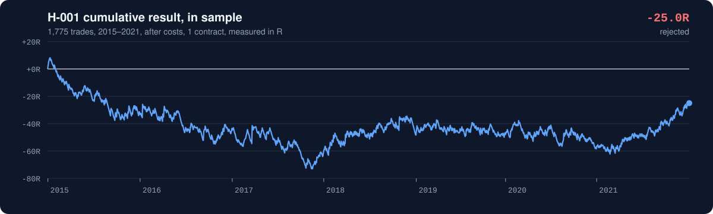
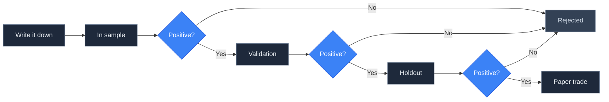
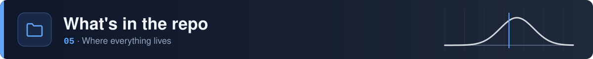

<picture>
  <source media="(prefers-color-scheme: dark)" srcset="./assets/banner-dark.svg" />
  <source media="(prefers-color-scheme: light)" srcset="./assets/banner-light.svg" />
  
</picture>

<br>

<div align="center">
  
  
  
  
  
  
</div>

<br>

Testing trading ideas on Nasdaq-100 E-mini (NQ) futures. Each idea is written down before it's tested, judged on expectancy after costs, and kept in the record whether it works or not.

> [!IMPORTANT]
> Paper trading only. Nothing here is financial advice, a signal, or a recommendation.

<br>

<picture>
  <source media="(prefers-color-scheme: dark)" srcset="./assets/section-record-dark.svg" />
  <source media="(prefers-color-scheme: light)" srcset="./assets/section-record-light.svg" />
  
</picture>

<div align="center">

| ID | Idea | Trades | Expectancy | 95% CI | Verdict |
|:---:|:---|:---:|:---:|:---:|:---:|
| [H-001](hypotheses/H-001-opening-range-breakout.md) | Opening range breakout | 1,775 | −0.014R | −0.08 to +0.05 |  |

<sub>Expectancy is per trade, in sample, after costs.</sub>

</div>

<picture>
  <source media="(prefers-color-scheme: dark)" srcset="./assets/h001-equity-dark.svg" />
  <source media="(prefers-color-scheme: light)" srcset="./assets/h001-equity-light.svg" />
  
</picture>

**H-001, in short:** buying or selling the first break of the opening 15 minutes made +0.024R per trade before costs and −0.014R after, which is noise either way. It was rejected on the in-sample period, so the validation and holdout years were never used. [Full results →](backtests/H-001-opening-range/results.md)

<br>

<picture>
  <source media="(prefers-color-scheme: dark)" srcset="./assets/section-process-dark.svg" />
  <source media="(prefers-color-scheme: light)" srcset="./assets/section-process-light.svg" />
  
</picture>



1. **Write it down.** A file in [`hypotheses/`](hypotheses/) states the claim, the exact rules, the costs, and the result that would prove it wrong. It's committed before any test, so the timestamp shows the idea came first.
2. **Test it.** Code, unit tests for the rules, and a `results.md` go in [`backtests/`](backtests/), one folder per hypothesis.
3. **Pass every gate.** Expectancy has to stay above zero after costs in each period, and in sample the low end of the 95% confidence interval has to be above zero too.
4. **Paper trade survivors.** Simulated trades go in [`journal/trades.csv`](journal/trades.csv) in a fixed format, so live expectancy is measured rather than guessed.

<br>

<picture>
  <source media="(prefers-color-scheme: dark)" srcset="./assets/section-splits-dark.svg" />
  <source media="(prefers-color-scheme: light)" srcset="./assets/section-splits-light.svg" />
  
</picture>

<picture>
  <source media="(prefers-color-scheme: dark)" srcset="./assets/splits-dark.svg" />
  <source media="(prefers-color-scheme: light)" srcset="./assets/splits-light.svg" />
  
</picture>

<br>

The periods were fixed before the first hypothesis existed and are recorded in [`decisions.md`](decisions.md). An idea that fails in sample never sees the later periods, so they stay clean for the ideas that come after it.

<br>

<picture>
  <source media="(prefers-color-scheme: dark)" srcset="./assets/section-data-dark.svg" />
  <source media="(prefers-color-scheme: light)" srcset="./assets/section-data-light.svg" />
  
</picture>

Every backtest loads bars through `nqlab.data`, so they all share the same cleaning rules.

```python
from nqlab import data

bars = data.load()                        # clean 1-minute bars in New York time
in_sample = data.split(bars, "in_sample")  # also "validation" and "holdout"
```

<div align="center">

| Column | Meaning |
|:---|:---|
| `open` `high` `low` `close` `volume` | The 1-minute bar |
| `session` | Trading date. The 18:00 ET open belongs to the next day. |
| `rth` | Regular hours, 09:30 to 16:00 ET |
| `roll_window` | Sessions around a quarterly contract roll |

</div>

<details>
<summary><b>What the cleaning does</b></summary>
<br>

- **Duplicates.** 112 timestamps appear twice, usually one bar with its volume split across two rows. They're merged and the volume is added.
- **Time zone.** The source is in UTC; everything is converted to New York time, including daylight saving.
- **Contract rolls.** Prices jump about 1% when the series switches to the next quarterly contract, and they aren't back-adjusted. Intraday strategies aren't affected. Anything held overnight must avoid `roll_window` sessions.
- **Broken sessions.** 9 sessions in 2025 with missing or mixed-contract data are dropped. The four March 2020 circuit-breaker halts are real market events and are kept.

`data.session_report()` shows the quality check for every session.

</details>

<details>
<summary><b>Setup</b></summary>
<br>

```bash
pip install -r requirements.txt
cp .env.example .env     # then set NQ_DATA_DIR to the folder with NQ_1min_<year>.parquet
python -m pytest
```

Market data isn't in the repo. It's licensed and can't be redistributed, and trade lists derived from it are git-ignored too.

</details>

<br>

<picture>
  <source media="(prefers-color-scheme: dark)" srcset="./assets/section-map-dark.svg" />
  <source media="(prefers-color-scheme: light)" srcset="./assets/section-map-light.svg" />
  
</picture>

```
nq-research/
├── hypotheses/        one file per idea, written before it's tested
├── backtests/         code, rule tests and results for each hypothesis
├── nqlab/             shared code: the data loader and research splits
├── journal/           paper trades, once something survives
├── tests/             tests for the shared code
├── assets/            README artwork and the script that draws it
└── decisions.md       why the process works the way it does
```

<br>

<picture>
  <source media="(prefers-color-scheme: dark)" srcset="./assets/section-rules-dark.svg" />
  <source media="(prefers-color-scheme: light)" srcset="./assets/section-rules-light.svg" />
  
</picture>

- **Rules are frozen at the commit.** Changing a rule after seeing a result makes it a new hypothesis, with its own file.
- **Failures stay.** Deleting rejected ideas would leave only the lucky ones, which is survivorship bias.
- **No mining the breakdowns.** Results are split by year, direction and regime to understand them, never to rescue a failed idea.
- **Costs are always in.** Commission and slippage come off every trade, and stops that are run through by a gap fill at the open.
- **Every claim gets a falsification test.** If nothing could prove an idea wrong, it isn't ready to test.

<br>

<p align="center">
  <sub>Part of <a href="https://github.com/nqedgelab">NQ Lab</a> · paper traded · not financial advice</sub>
</p>


