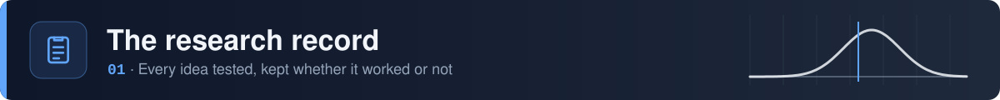
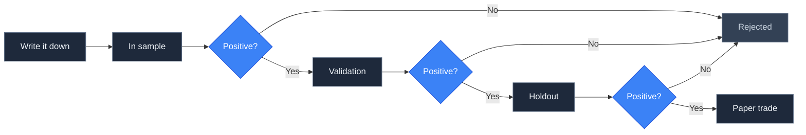
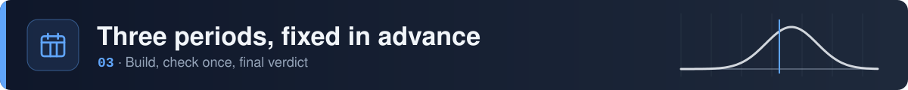
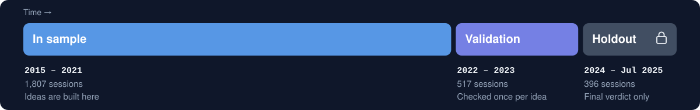
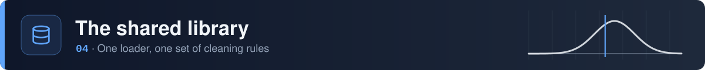
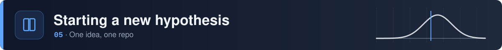
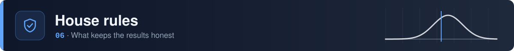

<picture>
  <source media="(prefers-color-scheme: dark)" srcset="./assets/banner-dark.svg" />
  <source media="(prefers-color-scheme: light)" srcset="./assets/banner-light.svg" />
  
</picture>

<br>

<div align="center">
  
  
  
  
  
  
</div>

<br>

The book for NQ Lab's research on Nasdaq-100 E-mini (NQ) futures. Every hypothesis gets its own repo, where it's written down, tested and judged. This repo keeps the whole record in one place: what was tried, what happened, what was learned, and the shared code every test runs on.

> [!IMPORTANT]
> Paper trading only. Nothing here is financial advice, a signal, or a recommendation.

<br>

<picture>
  <source media="(prefers-color-scheme: dark)" srcset="./assets/section-record-dark.svg" />
  <source media="(prefers-color-scheme: light)" srcset="./assets/section-record-light.svg" />
  
</picture>

<div align="center">

| | Hypothesis | Trades | Expectancy | 95% CI | Verdict | Chapter |
|:---:|:---|:---:|:---:|:---:|:---:|:---:|
| [H-001](https://github.com/nqedgelab/nq-h001-opening-range) | Opening range breakout | 1,775 | −0.014R | −0.08 to +0.05 |  | [Read](chapters/H-001-opening-range.md) |

<sub>Expectancy is per trade, after costs, on the furthest period each idea reached.</sub>

</div>

Each chapter tells the story of one hypothesis: why it was worth testing, what happened, and what it changes for the ideas after it. The code and full results live in the hypothesis's own repo.

<br>

<picture>
  <source media="(prefers-color-scheme: dark)" srcset="./assets/section-process-dark.svg" />
  <source media="(prefers-color-scheme: light)" srcset="./assets/section-process-light.svg" />
  
</picture>



1. **Write it down.** The hypothesis repo's first commit is `hypothesis.md`: the claim, the exact rules, the costs, and the result that would prove it wrong. The timestamp shows the idea came before any result.
2. **Test it.** The backtest goes in the same repo, with one unit test per trading rule.
3. **Pass every gate.** Expectancy has to stay above zero after costs in each period. In sample, the low end of the 95% confidence interval has to be above zero too.
4. **Write the chapter.** Whatever the verdict, the book gets a chapter and the record table gets a row.
5. **Paper trade survivors.** Simulated trades go in [`journal/trades.csv`](journal/trades.csv), so live expectancy is measured rather than guessed.

<br>

<picture>
  <source media="(prefers-color-scheme: dark)" srcset="./assets/section-splits-dark.svg" />
  <source media="(prefers-color-scheme: light)" srcset="./assets/section-splits-light.svg" />
  
</picture>

<picture>
  <source media="(prefers-color-scheme: dark)" srcset="./assets/splits-dark.svg" />
  <source media="(prefers-color-scheme: light)" srcset="./assets/splits-light.svg" />
  
</picture>

<br>

The periods were fixed before the first hypothesis existed and are recorded in [`decisions.md`](decisions.md). An idea that fails in sample never sees the later periods, so they stay clean for the ideas that come after it.

<br>

<picture>
  <source media="(prefers-color-scheme: dark)" srcset="./assets/section-data-dark.svg" />
  <source media="(prefers-color-scheme: light)" srcset="./assets/section-data-light.svg" />
  
</picture>

`nqlab` is the code every hypothesis shares. Each hypothesis repo installs it at a tagged version, so improving the loader later can't silently change an old result.

```python
from nqlab import data

bars = data.load()                         # clean 1-minute bars in New York time
in_sample = data.split(bars, "in_sample")  # also "validation" and "holdout"
```

<div align="center">

| Column | Meaning |
|:---|:---|
| `open` `high` `low` `close` `volume` | The 1-minute bar |
| `session` | Trading date. The 18:00 ET open belongs to the next day. |
| `rth` | Regular hours, 09:30 to 16:00 ET |
| `roll_window` | Sessions around a quarterly contract roll |

</div>

<details>
<summary><b>What the cleaning does</b></summary>
<br>

- **Duplicates.** 112 timestamps appear twice, usually one bar with its volume split across two rows. They're merged and the volume is added.
- **Time zone.** The source is in UTC; everything is converted to New York time, including daylight saving.
- **Contract rolls.** Prices jump about 1% when the series switches to the next quarterly contract, and they aren't back-adjusted. Intraday strategies aren't affected. Anything held overnight must avoid `roll_window` sessions.
- **Broken sessions.** 9 sessions in 2025 with missing or mixed-contract data are dropped. The four March 2020 circuit-breaker halts are real market events and are kept.

`data.session_report()` shows the quality check for every session.

</details>

<details>
<summary><b>What else is in the library</b></summary>
<br>

`nqlab.art` draws the README artwork for the book and every hypothesis repo: banners, section headers, the splits timeline and equity curves, each in a dark and a light version. Keeping it shared means every repo looks like part of the same book.

</details>

<br>

<picture>
  <source media="(prefers-color-scheme: dark)" srcset="./assets/section-book-dark.svg" />
  <source media="(prefers-color-scheme: light)" srcset="./assets/section-book-light.svg" />
  
</picture>

1. Create a private repo named `nq-hNNN-short-name`.
2. Copy [`templates/hypothesis.md`](templates/hypothesis.md) to `hypothesis.md`, fill it in completely, and commit it **before writing any backtest code**.
3. Add `requirements.txt` with `nqlab @ git+https://github.com/nqedgelab/nq-research@v0.1.0`, a `backtest/` folder with the test and its rule tests, and `results.md` once it's run. [nq-h001-opening-range](https://github.com/nqedgelab/nq-h001-opening-range) is the reference layout.
4. Add the chapter and the record row here.

<details>
<summary><b>Setup</b></summary>
<br>

```bash
pip install -e .          # installs nqlab from this checkout
python -m pytest
```

Put `NQ_DATA_DIR=<folder with NQ_1min_<year>.parquet>` in a `.env` file. The loader looks in the current folder and its parents, so one `.env` above all the repos serves every one of them. Market data is licensed and is never committed.

</details>

<details>
<summary><b>What's in this repo</b></summary>
<br>

```
nq-research/
├── chapters/          one chapter per hypothesis
├── nqlab/             shared library: data loader, research splits, artwork
├── templates/         the hypothesis template
├── journal/           paper trades, once something survives
├── tests/             tests for the library
├── assets/            README artwork and the script that draws it
└── decisions.md       why the process works the way it does
```

</details>

<br>

<picture>
  <source media="(prefers-color-scheme: dark)" srcset="./assets/section-rules-dark.svg" />
  <source media="(prefers-color-scheme: light)" srcset="./assets/section-rules-light.svg" />
  
</picture>

- **Rules are frozen at the commit.** Changing a rule after seeing a result makes it a new hypothesis, with its own repo.
- **Failures stay.** Deleting rejected ideas would leave only the lucky ones, which is survivorship bias.
- **No mining the breakdowns.** Results are split by year, direction and regime to understand them, never to rescue a failed idea.
- **Costs are always in.** Commission and slippage come off every trade, and stops that are run through by a gap fill at the open.
- **Every claim gets a falsification test.** If nothing could prove an idea wrong, it isn't ready to test.

<br>

<p align="center">
  <sub>Part of <a href="https://github.com/nqedgelab">NQ Lab</a> · paper traded · not financial advice</sub>
</p>


